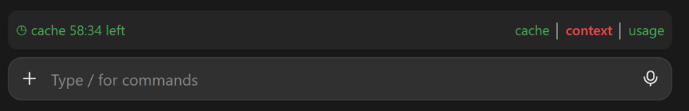
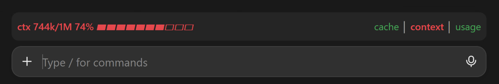
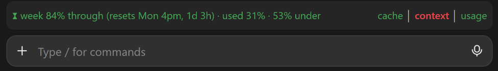

# cache-context-usage

A one-line bar above the Claude Code prompt:

```
cache │ context │ usage
```

Each word turns **green**, **yellow** or **red** so you can see at a glance where you stand. Click a word to open
its details on the left of the same line; click again to close them. A red item opens its details by itself.

Built on Ray Amjad's [cache-clock](https://github.com/ray-amjad/claude-code-mods/tree/main/plugins/cache-clock)
mod (MIT), as my capstone project for the **Chase AI masterclass**.
[Chase AI](https://www.youtube.com/@chaseai) is a YouTube channel about building real tools with Claude Code and AI
agents; the masterclass walks through it hands-on, and cache-clock was one of the mods in its lessons.

**cache** clicked: green, with the time until the prompt cache goes cold



**context** at 74% of the window: red, so its details opened by themselves



**usage** clicked: 84% through the week with 31% used, well under pace, so green



## What the words mean

| word | green | yellow | red |
|---|---|---|---|
| **cache** | prompt cache warm | 30 minutes until it goes cold | 15 minutes left, or cold |
| **context** | under 35% of the context window | 35% | 50% |
| **usage** | on pace for the week | 6 to 20 points ahead of the week | more than 20 points ahead, or 90% used |

**usage** compares your plan's weekly limit with how far through the week you are: 50% used halfway through the week
is green, 60% is yellow, 80% is red. It turns **cyan** in the last 24 hours before the reset when 20% or more is still
unused: time to spend it. The figures are the ones Claude's servers send back after each reply, so they cover your
whole account, every computer included. They show after the first reply of a session, and only on a Claude
subscription (an API key has no weekly limit).

Details, when clicked:

```
cache 47:05 left · sub 3:10 · 1h ttl measured
ctx 54k/1M 5% ▰▱▱▱▱▱▱▱▱▱
week 82% through (resets Mon 5pm, 1d 7h) · used 50% · 32% under · 5-hour 30%
```

You also get a pop-up 5 minutes before the cache goes cold and another when it has. `/cache-clock` prints everything
as text.

## Install

At the prompt of a Claude Code session:

```
/plugin install cache-context-usage --marketplace twiddows/cache-context-usage
```

answer `y` to add the marketplace, pick a scope, and start a new session. From a shell instead:

```
claude plugin install cache-context-usage --marketplace twiddows/cache-context-usage
```

**Where it shows.** The Claude desktop app (Code tab) loads mods on its own. A terminal `claude` session loads
them only with this in the `env` block of `~/.claude/settings.json`:

```json
"CLAUDE_CODE_ENABLE_FUNCTION_HOOKS": "1"
```

On the desktop the words themselves are coloured; in a terminal each word is a button with a coloured dot in front
for yellow and red.

## Settings

All optional, as environment variables in the `env` block of `~/.claude/settings.json`. Minutes may be fractional.

| variable | default | what it does |
|---|---|---|
| `CACHE_CLOCK_YELLOW_MIN` | 30 | cache turns yellow with this many minutes left |
| `CACHE_CLOCK_RED_MIN` | 15 | cache turns red and opens its details |
| `CACHE_CLOCK_WARN_MIN` | 5 | the "goes cold soon" pop-up |
| `CACHE_CLOCK_CTX_YELLOW_PCT` | 35 | context turns yellow at this share of the window |
| `CACHE_CLOCK_CTX_RED_PCT` | 50 | context turns red and opens its details |
| `CACHE_CLOCK_MAIN_TTL_MIN` | measured | the cache lifetime; normally read from the session itself |
| `CACHE_CLOCK_SUB_TTL_MIN` | 5 | subagents' cache lifetime |
| `CACHE_CLOCK_STYLE` | tray | `full` shows the whole line all the time, as the original cache-clock |
| `CACHE_CLOCK_TRAY` | client | `buttons`: on the desktop, clickable icons beside coloured words instead |
| `CACHE_CLOCK_SOUND` | off | `1` plays a sound with the "goes cold soon" pop-up |
| `CACHE_CLOCK_ON_WARNING` | off | `handoff`: if you haven't replied at the warning, Claude writes `HANDOFF-<id>.md` in the project root |
| `CACHE_CLOCK_JOBS_DIR` | (none) | a folder of markdown notes; the newest note's numbered bold lines (`**1. Title**`) show in the usage details as things to spend spare usage on, with an **open** button |
| `CACHE_CLOCK_OPEN_URL` | system opener | how **open** opens that note, `{path}` standing for its path, e.g. `obsidian://open?path={path}` |

## Develop

```
claude plugin validate .
claude plugin test .
```

The tests check what the mod draws, not how a surface paints it; look at it in a real session before trusting a
visual change.

## License

MIT. See `LICENSE`: Ray Amjad's original and this version.
